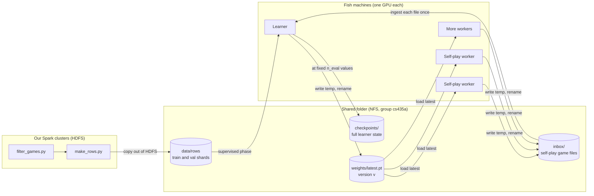
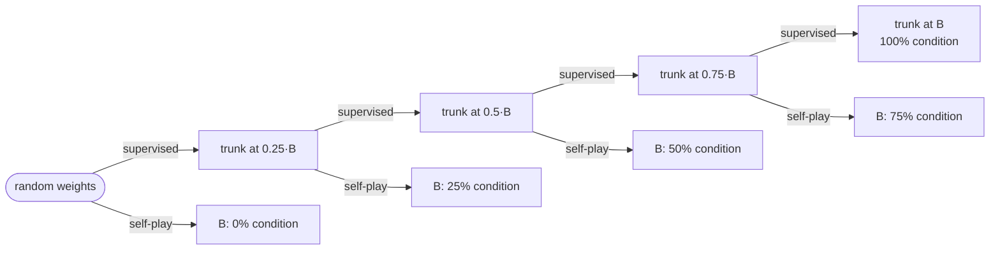
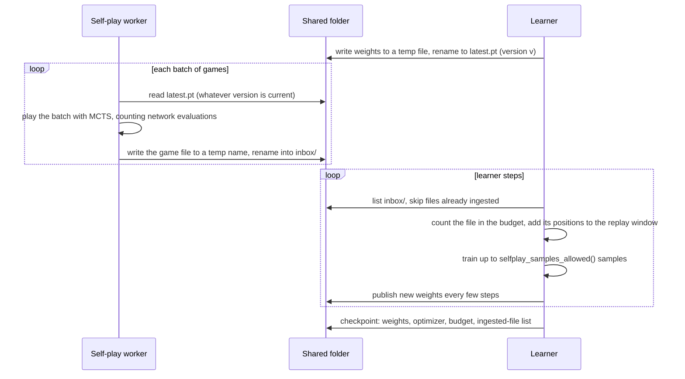

# The training system as a distributed system

How a run's processes are laid out across machines, how they hand data to each
other, what each guarantees, and what we measure. It's written for the team and as
source material for the write-up's systems section.

Status labels: **built** means implemented and tested; **decided** means agreed in
`docs/decisions.md` but not yet coded; **proposed** means open for discussion.
Sources are cited by key from [references.md](references.md).

## 1. Overview

Each condition has **one learner**, the only stateful process, and **many
stateless self-play workers**, one per fish machine GPU. They never talk to each
other directly. Every hand-off is a file on the shared folder, a department NFS
drive that every lab machine mounts. The human data is produced separately by Spark
on our own clusters and copied to the same folder (decision #7).

This is an **actor-learner** architecture. It's the same shape as Ape-X, where many
actors fill a replay memory that one learner trains from and periodically sends new
parameters back [ApeX], and as IMPALA's decoupled actors and learner [IMPALA]. It
also follows AlphaZero's choice of a single network that's updated continually,
with self-play always using the latest parameters [AlphaZero-arXiv].

**Why files, not a framework:** we have no cluster manager on the fish machines,
the machines are shared with other students, and workers need to start and stop at
any time (CLAUDE.md, Architecture). Files on NFS need no running service, survive
any process crashing, and leave a record we can analyse afterwards.

## 2. A run's lifecycle

**Built:** `chesszero/budget.py`. **Proposed:** branching (decision #24).

The budget B is counted in network evaluations (decision #1). A run trains on human
rows until n_eval reaches p·B, then plays itself until n_eval reaches B. If
branching is adopted, one supervised run (the "trunk") serves every condition from
25% up: its checkpoints at 0.25·B, 0.5·B and 0.75·B each continue as a condition's
self-play phase, and the trunk itself continues to B as the 100% condition.

Checkpoints fall at multiples of `checkpoint_every`, the same n_eval values in every
condition, and B is a multiple of 4 × `checkpoint_every`, so every switch point is a
checkpoint (decision #25). Each branch starts from the trunk's full checkpoint and
keeps its count, so it starts at p·B rather than 0.

## 3. The self-play loop

**Decided** in decision #25; to be implemented in `training/selfplay_worker.py` and
`training/train_selfplay.py`.

- **Workers** load the newest weights before each batch, play many games in
  lockstep with batched network calls, and write one file per batch (tens to a few
  hundred games). Each file records the worker's host, the weights version it
  played with, the network evaluations it used, games, plies, and start and end
  times (decision #25).
- **The learner** is the only process that changes shared state. It ingests game
  files, counts them in the budget, trains, publishes weights, and checkpoints.

## 4. Guarantees and how each is achieved

| Property | Mechanism | Status |
|---|---|---|
| **No reader sees a half-written file** | Write under a temporary name in the same directory, then rename. A rename within one directory replaces the file in a single step. | Decided (CLAUDE.md) |
| **Each game file counts exactly once** | The learner's checkpoint stores the names of every file it has ingested, and file names are unique (host, process ID, sequence number). After a restart, the learner skips files already in that list. | Decided (#25) |
| **The budget is counted in one place** | Only the learner holds a `Budget`. Self-play evaluations count when a file is ingested, not when it's generated, so work that never reached the model isn't counted. | Built (`budget.py`) |
| **The training-to-data ratio doesn't depend on how many machines are free** | The learner trains at most `train_samples_per_position` samples per self-play position ingested, and waits for data when it's ahead. | Built (`selfplay_samples_allowed`) |
| **Phases can't overlap** | Self-play files ingested during the supervised phase raise an error instead of being counted. | Built |
| **Workers can come and go** | Workers hold no state. A killed worker loses at most its current batch, which was never counted. | Decided (CLAUDE.md) |
| **The learner can crash and resume** | It restarts from its last checkpoint: weights, optimizer, budget and ingested-file list. | Decided |

**Crash recovery and the inbox.** After a crash, the learner returns to its last
checkpoint, so files ingested since then are no longer in its ingested list and get
ingested again. That's correct, because the model and the budget have also gone back
to that point. It only works if those files are still there.

The replay window raises the same problem. Ingesting a file adds its positions to
the window, and the learner samples from the window over many later steps, so a
file can be ingested long before all its positions have been trained on. If the
window lives only in memory, a restarted learner can rebuild it only from files
still on disk.

**Proposed retention rule:** keep a game file until both of these hold:
1. a checkpoint lists it as ingested, and
2. its positions have aged out of the replay window.

After that, the learner moves its metadata into the ingest log and deletes it, or
keeps it in the archive (section 8). The alternative is to save the replay window in
a separate checkpoint file, never in the weights file workers load, so files can go
as soon as a checkpoint covers them. That makes each checkpoint larger.

As a rough estimate, not yet measured: the bulk of a game file is the visit counts,
about 35 moves per position, so a window of half a million positions needs a few
hundred MB per condition.

**NFS visibility.** A file renamed on one machine can take a few seconds to appear
on another (CLAUDE.md, File hand-off rules). Workers may load a slightly older
weights version, and the learner may see an inbox file one scan later. Both are
harmless here: the first is ordinary staleness, which we measure, and the second is
a short delay.

## 5. Staleness and backpressure

Workers play with whatever weights were current when their batch started, so the
learner trains on games generated by older versions of the network. This is
**bounded staleness** in the sense used for distributed machine learning, where
reads may lag writes by a bounded amount [ParamServer]. AlphaZero accepts it
without correction [AlphaZero-arXiv]. IMPALA corrects for the same lag in its
policy-gradient updates with an off-policy correction [IMPALA]. Our policy targets
are MCTS visit counts rather than policy-gradient updates, so like AlphaZero we
don't correct for it, but we measure it.

**Proposed:**
- **A staleness bound.** The learner could discard files whose weights version is
  more than K versions old. Today nothing enforces a bound; the measured
  distribution in section 6 will show whether one is needed. Discarded files are
  recorded with `budget.add_discarded`, outside n_eval.
- **Backpressure on workers.** The learner already waits when it's ahead of the
  data. The opposite case, workers outpacing the learner, makes the inbox grow and
  the data grow staler. Workers could pause while the inbox holds more than a set
  number of unread files. The learner would then ingest files only as it needs
  them, so the inbox acts as a bounded queue.

## 6. What we measure

These are the numbers that describe the self-play system as a distributed system,
for the write-up and the scaling test (`experiments/scaling_test.py`, 1, 2, 5 and 10
machines). Most come straight from the game-file metadata and the learner's ingest
log (decision #25).

| Measurement | Meaning | Source |
|---|---|---|
| Self-play throughput | Network evaluations and games per second, per worker and in total | Game-file metadata |
| Scaling | Throughput against number of machines; ideally linear until the learner or NFS becomes the bottleneck | Scaling test |
| Staleness | How many weight versions behind the learner each file was when ingested | Game file's weights version against the learner's version at ingest |
| Ingest lag | Time from a file being written to being ingested | File end time against ingest time |
| Learner wait time | Share of time the learner waits for data (workers are the bottleneck) | Learner log |
| Inbox backlog | Unread files over time (the learner is the bottleneck) | Learner log |
| Discarded work | Evaluations and games that never reached training | `Budget.discarded_*` |
| Wall time per condition | Real time to spend B, checked against the pilot's forecast | Checkpoint timestamps |

## 7. Alternatives we considered

- **Generation-based training with a barrier.** All workers play one generation
  with the same weights, then wait while the learner trains and checks the new
  network against the old one. This is the loop in the alpha-zero-general reference
  code [AZGeneral]. It has no staleness or discarded work, but machines sit idle
  waiting for the slowest worker and for training.
- **AlphaGo Zero's evaluator gate.** Training, evaluation and self-play run in
  parallel, but self-play uses the best network so far, as chosen by an evaluator
  [AlphaGoZero]. AlphaZero dropped this step and always uses the latest
  parameters [AlphaZero-arXiv], which is simpler and what we do.
- **A distributed framework such as Ray.** It would handle scheduling and messaging,
  but needs a running cluster service we don't have on shared lab machines.
- **Counting the budget at the workers.** It would count work that never affected
  the model, and spread the count across processes (decision #25).
- **Distributed training of the learner (DDP).** Probably unnecessary for a network
  of about 2.6M parameters. A small side experiment remains optional (CLAUDE.md).

## 8. Open items

- Game file format and naming: decided in principle (batched, atomic, unique
  names, metadata from #25), but the exact format isn't fixed yet.
- How often the learner publishes weights, and how weight versions are numbered.
- Whether to enforce a staleness bound or worker backpressure (section 5).
- **Archive of self-play games (proposed).** Keep a small, useful sample rather
  than every game:
  - **Metadata for every file, forever:** host, weights version, evaluations, games,
    plies and times go into the learner's ingest log before the file is deleted. It's
    small and is all section 6's measurements need.
  - **A systematic sample,** such as every Nth file per condition, so there are games
    from every stage of training.
  - **Flagged games,** chosen with cheap checks at ingest rather than Stockfish:
    checkmates, games that hit the move cap (draw rate, decision #17), very long
    games, and large swings in the search's value estimate, which mark blunders.
  - **Stockfish scoring afterwards, offline,** with `evaluation/move_analysis.py` on
    the archive. Stockfish is too slow to run on every game as it's ingested.
  - Archived games export as PGN, which Lichess and chess.com import directly.
- `train_samples_per_position` and `checkpoint_every`, which the pilot sets.
